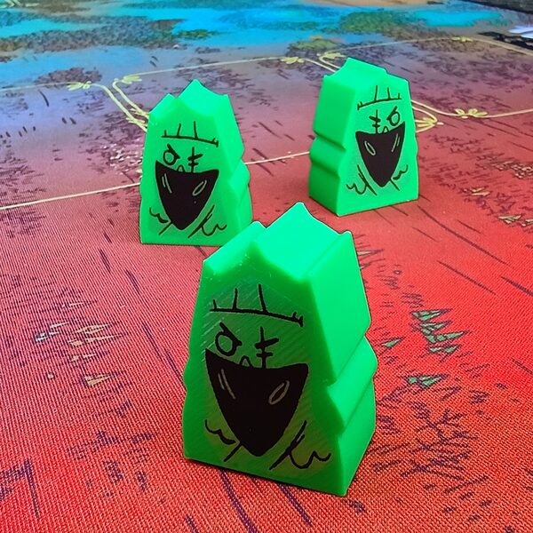
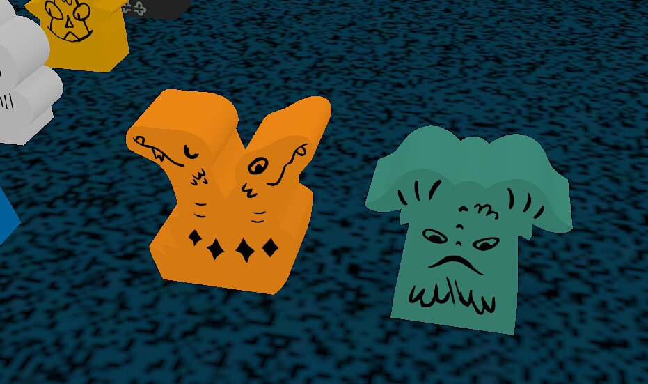

# oath-colors

  
  &nbsp;
  

## command-line tools for custom player components for Oath:Chronicles of Empire and Exile

Say you came up with a spiffing idea for a cute new pawn for Oath by Buried Giant Studios. You could draft a .svg of the player pawn and the warbands, and then it would be nice to be able to either:
- 3D print the new meeples
- Import the art into Tabletop Simulator

This repo contains tools for doing both things. 

## System Requirements
- A unix-like system, and a little familiarity with it. I used Linux though MacOS will probably work without too much trouble. Windows might work if you knew your way around. 
- A willingness to run vibe-coded software by yours truly. I haven't even read some of the code. Beware, ha ha. 

## Workflow
1. Check out this repo to someplace you want to work.
2. Drop a player pawn and a player warband svg into that directory. I strongly recommend the file naming convention `<name>-{pawn,warband}-v<digits>.svg`. For example, `orange-pawn-v03.svg` and `orange-warband-v03.png`. 
3. Install [uv](https://docs.astral.sh/uv/), the python package manager.
4. _I probably forgot to list some other dependencies here, like `make`_
5. Type `make` and check the output for errors

## Outputs

### Tabletop Simulator

- `.obj` file
- `.png` file

For real multiplayer games, I think you'll need to find web hosting for these files, or appeal to the mod creators to add them to the mod. However, it's easy to test them in TTS for local-only games.

To do so, in TTS go `Objects > Custom > MODEL`, click where you want the new pawn, then press esc, then put the path to the `.obj` in Model/Mesh, and path to the `.png` in Diffuse/Image. I checked `Figurine` too. Click OK. 

### Printing

- `.stl` files - there's one for the warband, one for the pawn, and one "plate" that is a combination of one pawn and 14 warbands - enough for a player faction. 
- `-ink.svg` file - I arrange these black markings onto a pdf and then print on decal paper. Then I cut out the decals and apply them with hot water. See `README.md`s in super-directories for tips and tricks on that. 

Custom tuckboxes and player boards are outside the scope of this project. 

### Blender &c

- `.mtl` file - material file that links the `.obj` and `.png` files in some 3d editors. You can safely ignore it. 

